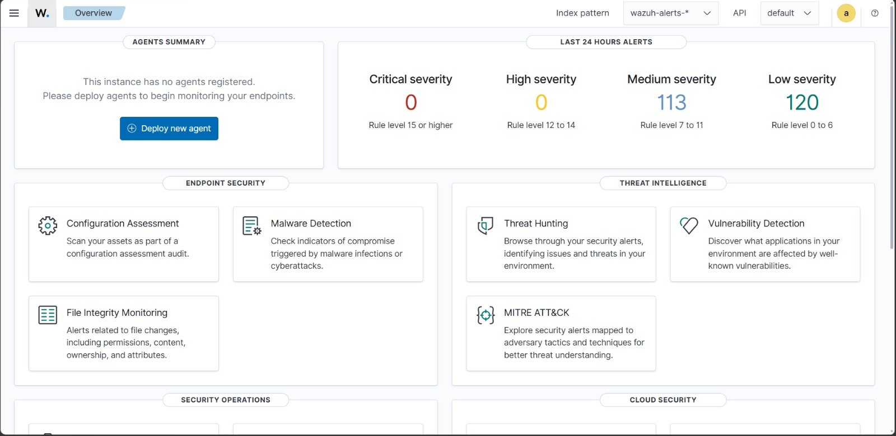
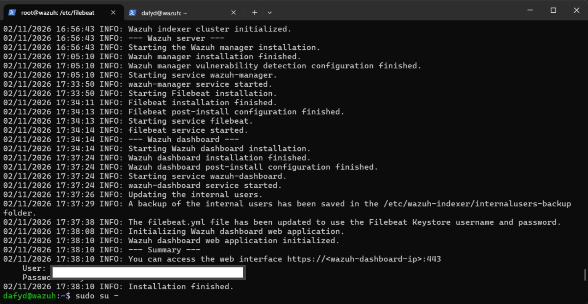
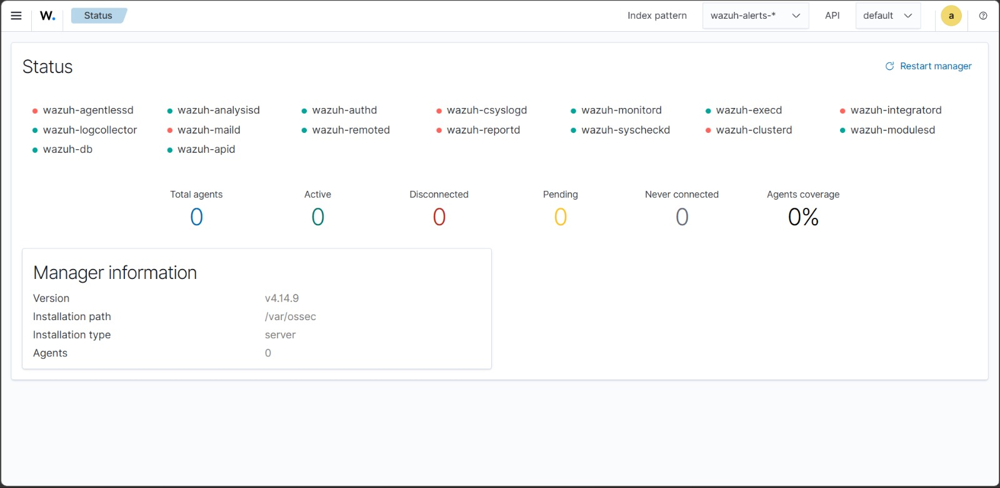

# Day 01 – Wazuh Server Deployment

## Overview

Day 1 of my 7-day hands-on project: **Building a Security Operations Center (SOC) Lab Using Wazuh**.

The objective of this phase was to deploy the Wazuh server in an Ubuntu virtual machine using VMware and establish the foundation for centralized security monitoring.

## Objectives

- Set up an Ubuntu virtual machine using VMware.
- Install and configure the Wazuh server.
- Deploy Wazuh Manager, Wazuh Indexer, and Wazuh Dashboard.
- Configure Filebeat for alert forwarding.
- Access and explore the Wazuh web interface.
- Verify the server installation and service status.

## Lab Environment

| Component | Configuration |
|---|---|
| Virtualization | VMware |
| Operating System | Ubuntu Linux |
| Security Platform | Wazuh |
| Wazuh Version | 4.14.9 |
| Deployment Type | Single-node server |
| Interface | Wazuh Web Dashboard |

## Architecture

The Wazuh server deployment consists of the following components:

1. **Wazuh Manager:** Collects and analyzes security events from connected agents.
2. **Wazuh Indexer:** Stores and indexes security event data.
3. **Wazuh Dashboard:** Provides a web-based interface for security monitoring and analysis.
4. **Filebeat:** Forwards Wazuh alerts to the Wazuh Indexer.

## Implementation Steps

### 1. Ubuntu Virtual Machine Setup
- Created an Ubuntu virtual machine using VMware.
- Configured the virtual machine environment.
- Updated and prepared the operating system for Wazuh installation.

### 2. Wazuh Server Installation
- Installed the Wazuh central components.
- Deployed Wazuh Manager.
- Configured Wazuh Indexer.
- Installed and configured Filebeat.
- Deployed Wazuh Dashboard.

### 3. Dashboard Access
- Accessed the Wazuh web interface through a browser.
- Verified that the dashboard was accessible.
- Explored the security monitoring interface and available modules.

### 4. Installation Verification
Verified the following:
- Wazuh Manager installation completed.
- Wazuh Indexer cluster initialized.
- Filebeat installation completed.
- Wazuh Dashboard installation completed.
- Wazuh Manager information displayed in the dashboard.

## Screenshots

### 1. Wazuh Dashboard Overview

### 2. Installation Completion

### 3. Wazuh Manager Status

## Outcome

Successfully deployed the Wazuh server and accessed its web dashboard.

The server-side infrastructure is ready for the next phase of the project: integrating endpoint agents and collecting security telemetry.

## Key Learnings

- Understanding the basic architecture of Wazuh.
- Learning the role of Wazuh Manager, Indexer, and Dashboard.
- Understanding how Filebeat forwards security alerts.
- Exploring the Wazuh security monitoring interface.
- Gaining hands-on experience with Linux-based security infrastructure deployment.

## Next Steps – Day 02

- Install Wazuh Agent on a Windows endpoint.
- Connect the endpoint to the Wazuh Manager.
- Verify agent registration and connectivity.
- Start collecting endpoint security events.

---

**Project:** Building a SOC Lab Using Wazuh

**Progress:** Day 1 / 7 – Completed

**Purpose:** Hands-on cybersecurity learning and Blue Team skill development.